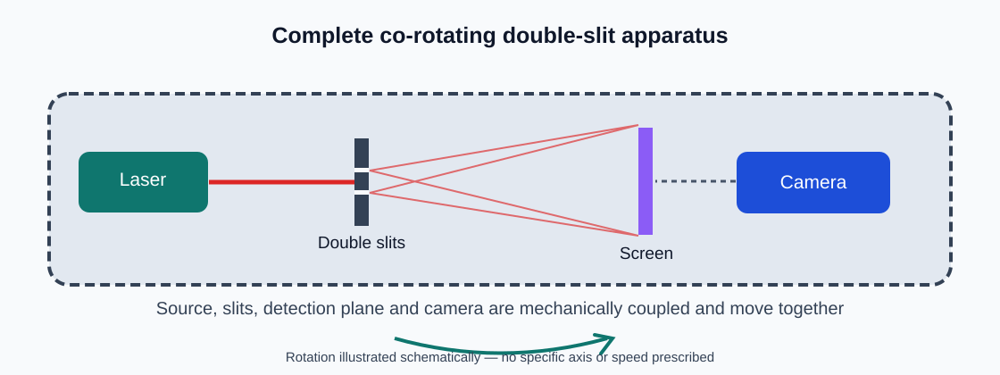

# Co-rotating double-slit experiment — open research proposal

**Concept and initial experimental proposal: Tonino Schafer (independent proposer).**

**Status:** Unreviewed experimental proposal; not an experimental result, independent replication, or verified discovery. Prepared 16 November 2026. The first **public** publication date is established by this repository's first public commit, not by earlier private discussions.

## The experiment

Rather than rotating only the double-slit mask, the proposal mounts **the laser source, double slits, observation screen and imaging camera together on a rigid apparatus** and rotates the entire assembly. It asks whether any measured change in fringe visibility remains **after controlling for mechanical deformation, shutter integration, motion blur, optical drift, air movement, and known inertial effects**.

A proposed physical-wake or substrate mechanism motivates the test, but no quantitative alternative theory or observed anomaly is claimed. Classical laser interference cannot by itself resolve the quantum measurement problem; a later single-photon implementation would require a substantially different experimental design.

## Read the proposal

- [Research paper](PAPER.md)
- [Experimental protocol](PROTOCOL.md)
- [Historical attribution and evidence limitations](HISTORY_PROVISIONAL.md)
- [Invitation to collaborate](COLLABORATION.md)
- [How to cite the project](CITATION.cff)

## Research question

**Can carefully controlled whole-rig motion produce a reproducible change in double-slit fringe visibility beyond predictions of conventional optics and known motion-dependent effects?**

This proposal does not assume that rotation is unstudied. Rotating interferometers, moving-slit experiments and inertial phase effects are established subjects. We do not claim priority over all previous related research or that any particular outcome would prove a physical-wake mechanism.

**An observed reduction in interference contrast would not establish the physical-wake conjecture.** Ordinary artifacts must be eliminated and any residual replicated. A null result is also useful if its sensitivity is reported.

## Attribution and evidence

This experiment and its motivating conjecture are presented as an idea proposed by **Tonino Schafer**. Reconstructed conversation-history notes point to a separate spatial-substrate idea in November 2024 and to the complete co-moving apparatus and wake conjecture in November 2025. **Original conversation transcripts have not yet been independently checked against a ChatGPT data export**, so these historical dates are provisional and should not be treated as proof of scientific priority. See [HISTORY_PROVISIONAL.md](HISTORY_PROVISIONAL.md).

Please cite this proposal and name its originator if discussing or adapting the concept. Collaborators must also receive appropriate credit for their own substantial research contributions.

## Collaboration

Experimental optics laboratories, rotational-metrology specialists, image-analysis researchers and quantum-interferometry groups are invited to review the idea and help test it rigorously. Please [open an issue](https://github.com/ToninoS/rotating-double-slit-experiment/issues) to discuss feasibility, related work, or collaboration.

**This is a proposal, not a discovery. No DOI or peer review is claimed.** No license is specified yet; linking and normal academic citation are encouraged, but permission to reproduce the authored text is not automatically granted.
